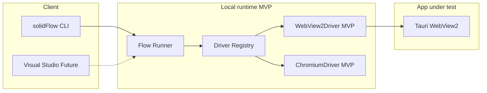
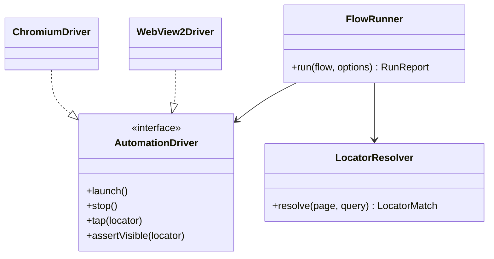

# SolidFlow system architecture

Status legend: **MVP** = implemented in this repo; **Future** = designed extension point.

## System context

## Folder structure

| Path | Role | Status |
|------|------|--------|
| `src/cli.ts` | CLI entry | MVP |
| `src/flow/` | Parse, validate, execute YAML | MVP |
| `src/driver/` | Automation drivers + locator fallback | MVP |
| `src/report/` | HTML, JSON, JUnit | MVP |
| `src/inspector/` | Hierarchy dump + static viewer | MVP |
| `src/recorder/` | CDP injection + YAML export | MVP |
| `schema/flow.schema.json` | Authoring schema | MVP |
| `docs/architecture.md` | This document | MVP |

Future platform (not shipped): `services/orchestrator` (Spring Boot), `services/device-farm`, `proto/solidFlow/v1/*.proto`, `studio/` (React), `deploy/k8s/`.

## Logical data model (future PostgreSQL)

| Entity | Fields (conceptual) |
|--------|---------------------|
| Organization | id, name, settings |
| User | id, org_id, role (RBAC) |
| Device | id, platform, status, pool_id |
| Run | id, flow_id, status, started_at, device_id |
| StepResult | id, run_id, command, duration_ms, locator_confidence |
| Artifact | id, run_id, type (screenshot, video, log), s3_key |

MVP persists runs as filesystem directories under `<workspace>/test-results/<timestamp>_<flow>/`.

## API design

**MVP:** CLI only; no network API.

**Future gRPC (sketch):**

- `DeviceService.ListDevices`, `AcquireDevice`, `ReleaseDevice`
- `RunService.StartRun`, `StreamRunEvents`, `GetRun`
- `FlowService.ValidateFlow`, `UploadFlow`

Messages carry `FlowSpec`, `RunOptions` (tags, env, retry), `StepEvent`.

## gRPC contracts (future)

Protobuf package `solidFlow.v1`; runners connect as clients to orchestrator. Local CLI remains a thin client that can run standalone without orchestrator.

## Mobile automation engine (future)

| Platform | Stack |
|----------|--------|
| Android | ADB, UIAutomator2, accessibility |
| iOS | XCTest, WebDriverAgent |

MVP: `AndroidDriver`, `IosDriver` throw `DriverNotAvailable`.

## Device manager (future)

- Pools, tags, parallel workers
- MVP: single Windows desktop, mutex on the flow `appPath` (or `appId` when the flow has no exe path)

## Recorder & inspector

- **MVP:** CDP-based capture script; static HTML viewer with tree + screenshot
- **Future:** SolidFlow studio as a React app (Tailwind, Zustand, Monaco)

## Test runner

MVP: sequential steps, per-step retry, `repeat`, `if`, `runFlow`, tag filter on CLI, env interpolation `${VAR}`.

Future: RabbitMQ job queue, Redis device locks, horizontal runners on Kubernetes.

## Assertions

MVP: visible, hidden, text (exact/partial/regex), pixel diff (`assertScreenshot`).

Future: OCR plugin, AI failure analysis.

## Reporting

MVP: HTML timeline, JSON machine report, JUnit for CI.

Future: S3 artifact store, video, distributed timeline merge.

## AI features (future)

- NL → YAML generation
- Self-healing locators (LLM + confidence); MVP uses deterministic locator fallback only
- Failure analysis from screenshots + hierarchy diff

## Security (future)

OAuth2, JWT, RBAC, encryption at rest, audit logs. MVP: local-only, no secrets in flows.

## Scalability target (future)

10,000 concurrent executions via K8s device farm; not applicable to MVP local CLI.

## CI/CD

- **solidFlow repo:** `pnpm test` on every change
- **CIM export tool:** optional job with `SOLIDFLOW_APP_PATH` set, running a flow from the selected workspace

## Class diagram (core MVP)

## Roadmap

### MVP (this repo)

- YAML commands listed in README
- WebView2 + Chromium drivers
- CLI, reports, inspector, recorder
- CIM login validation example

### Production phase 1

- Spring orchestrator, Postgres, Redis locks
- Android emulator driver
- HTML studio (read-only viewer + YAML editor)

### Production phase 2

- iOS simulators, device farm, cloud `solidFlow cloud start`
- OAuth/RBAC, S3 artifacts
- VS Code extension (schema + lint)

### Production phase 3

- AI test generation and healing
- 10k scale K8s runners
- Web driver, desktop macOS/Linux
